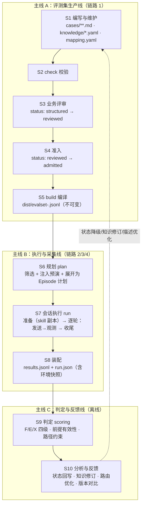

# 自动化评测业务过程总览

版本：v3.2（2026-10-22，修订记录见第 11 节）

## 1. 目标与范围

对 ElineAI（dsh 兼容 CLI 形态）做基于 markdown 用例的自动化评测：用例以文件系统维护，编译成结构化评测集；执行器筛选、注入、逐轮驱动 ElineAI；采集每轮回答与工具/skill 调用信号，装配成**单文件即可分析**的结果；判定离线进行。

| 在范围内 | 不在范围（本期） |
|---|---|
| 用例/评测集的生产过程（编写→校验→评审→准入→编译） | 判定模型（judge）选型与调优 |
| 执行、注入、请求、采集、装配的执行期过程 | 报表平台、回归门禁、CI 触发 |
| 产物契约、版本与环境快照 | 检索过程与忠实度分析 |
| 反馈闭环（状态回写、知识修订、路由优化） | 动态用户模拟、压缩/子 agent 场景 |

用例**怎么写**见 [CASE-STRUCTURE.md](CASE-STRUCTURE.md)；本文件及后续各篇只定义**过程**。

**过程重量原则**：凡是需要人记住去做的事，要么由工具完成，要么删掉。本目录中出现的每一条规则，要么是工具的行为，要么是一次性的人工决策；不设靠清单自觉维护的簿记。

## 2. 前置条件（阻断项）

以下两项未完成前，**ec 维度不运行**，其余维度在 ElineAI 默认 skill 配置下运行（不走副本机制）。完成后按 [03](03-执行过程与注入.md) 第 5 节的统一物化方式运行全部维度。

**过渡期结果自成基线**：过渡期 run 的环境快照记 `skills_mode: default-roots`（P0 完成后为 `isolated`），`skills_base` 取默认根可见 skill 的清单哈希。两种 mode 的 run 之间不做版本对比——P0 完成后用 isolated 模式重跑一次全量，作为新基线重新对表。

| # | 事项 | 做法 | 产出 | 决定什么 |
|---|---|---|---|---|
| P0-1 | 隔离机制现场验证 | **首轮已完成（2026-10-22，结论：两条路线均未通过，过渡期模式可用）**：① overlay 路线（customSkillDirs + includeDefaultRoots:false）在该版本（dsh 0.2.0-rc.2）无效——custom 根不出现、bundled 仍可见；skill-filesystem 的 dshHome 交换同样未生效（目录仍为原版）。② 退路（复制 home + 改 skills）被凭据阻断：ACCOUNT_SIGN_IN_REQUIRED，登录态不可随 home 复制。③ 同时确认 `~/.dsh` 的 evalheadless 已被改为 zhipu 直连（与昨日 deepseek-account 不同），评测 CLI 通道改用 `DSH_HOME=~/.eline`（凭据有效，已由真实试跑证明）。**下一步**：与平台方确认 skill 根隔离的正确机制（或 CLI 升级后按同法复验 overlay）；在此之前 ec 维度维持阻断，kr/mt/sc 走 default-roots | 验证记录：`runner/out/`、`tools/p0-1-verify.mjs`、本表 | ec 何时解禁；overlay 是否随版本修复 |
| P0-2 | skill 目录盘点 | 在 ElineAI 默认配置（与真实用户一致）下导出会话可见的 skill 清单：名称、来源根（内置 / 用户 / 项目）、文件路径；同名 skill 记录实际生效的是哪一份。名称清单可直接解析既有会话日志的 `<available_skills>` 目录消息生成，来源根对照各根目录补齐 | `runner/skills-inventory.yaml` | 基底 = 生产可见的全部 skill（不只用户根）；Profile 的 `skills_roots` 按盘点结果填写。**注意双 home（2026-10-22 盘点实测）**：`~/.dsh/skills` 16 个、`~/.eline/skills` 21 个，两者**不是相同拷贝而是分叉集合**（.eline 独有 trade-company 等 5 个）；生产目录消息 22 个 = 两根并集 + 1 个 CLI 内置（diagnose-windows-sandbox-acl）。CLI 通道实际生效根为 `.dsh`（base directory 实证），`skills_roots` 按此顺序填写（.dsh 优先），同名生效来源以 P0-1 现场确认为准；内置 skill 根的位置在 P0-1 时一并确认 |

P0-2 的原因：`includeDefaultRoots: false` 会去掉 ElineAI 自带的内置 skill。如果内置 skill 在生产中参与路由，而评测基底只有用户根的 21 个 skill，评测环境就与真实用户看到的目录分叉，路由类结论失真。

**盘点自维护**：盘点结果记录导出时的 agent 版本，以及各默认根的 skill 清单哈希（名称 + 内容）。执行器在每次 run 规划时重新计算这两项并与盘点记录比对，任一不一致即在 `--dry-run` 与 run.json 中提示"inventory 过期"，由负责人重导盘点。P0-2 因此不是一次性动作，也不需要有人记得在升级后重做。

**链路切换（2026-10-22 下午）**：执行器已改为驱动 ElineAI 客户端自带链路（eline.exe --expose-internals 执行 asar 内 dsh-desktop-host CLI，rc.6；DSH_BUNDLED_SKILL_DIR 挂 asar 内产品 21 个 trade skill；persona 复制自产品 trade-expert preset）。真实 E2E 6/6 ok 且 natural 模式 skill 自然路由加载。详见 03 §7.1。

**P0-2 进展（2026-10-22）**：`tools/p0-2-inventory.mjs` 已实现并从昨日真实日志完成首轮导出（22 个可见 skill，21 个定位到两个用户根，1 个 bundled 待定位）→ `runner/skills-inventory.yaml`。剩余动作：P0-1 现场确认同名生效来源与 bundled 根位置后补全。

## 3. 端到端视图

四条核心链路组织为**三条主线 + 一个闭环**：



- **主线 A** 产出不可变的评测集版本；**主线 B** 消费一个指定版本，产出带环境快照的运行结果；**主线 C** 只读结果即可工作，结论回流主线 A。
- 三条主线可以由不同角色在不同时间推进：A 是持续的业务过程，B 是一次运行（run），C 是离线批处理。

## 4. 阶段与门禁

| 阶段 | 动作 | 输入 → 输出 | 负责 | 关键规则 |
|---|---|---|---|---|
| S1 编写与维护 | 写用例 md、登记注入点 | 素材 → `cases/**/<id>.md`、`knowledge/<skill>.yaml` | 用例作者 | md 唯一数据源；参考答案、证据、注入都写在 md/knowledge，不另建库 |
| S2 check 校验 | 静态校验 | 用例源 → 问题清单（带行号） | 用例作者 | 报错必须清零；见 [02](02-评测集构建过程.md) 第 4 节 |
| S3 业务评审 | 专家按事实必要性、问题充分性审 | `structured` → `reviewed` | 业务审阅人 | reviewed 前参考答案必填、事实来源无未标注 |
| S4 准入 | 冻结该用例进入评测集 | `reviewed` → `admitted` | 评测负责人 | 只有 admitted 参与 build（可参数放宽） |
| S5 build 编译 | 变体展开、注入解析、随行字段带出、与上一版自动 diff | 用例源 → `dist/evalset-<ver>.jsonl` + diff | 工具（md2case） | 任何文件有错即不产出；产物按版本不可变 |
| S6 规划 | 筛选 + 按 Profile 能力展开 + 注入预演 | dist + Profile → Episode 计划 | 执行器 planner | 做不到的在此跳过并写明原因；--dry-run 可预览 |
| S7 会话执行 | skill 副本物化 + 逐轮驱动 ElineAI + 观测 | Episode 计划 → `.work/<episode>/` | 执行器 EpisodeRunner | 任何一轮非 ok 即停止该会话；不重试，靠 trials 独立采样 |
| S8 装配 | 组装 EpisodeRecord、追加结果、写环境快照 | `.work/` → `results.jsonl`、`run.json` | 执行器 store | 每行自包含（含随行字段），完成即追加，支持 --resume |
| S9 判定 | 事实四级判定、禁止事实、前提有效性、路径约束 | `results.jsonl` → 判定明细与聚合 | scoring | 只读 results.jsonl 即可完成；前提不成立 → episode 无效不计错，前提成立率随通过率一起报 |
| S10 分析与反馈 | 维度/主题/干预聚合、归因、回写 | 判定明细 → 结论与动作 | 评测负责人 | 见第 8 节闭环 |

**四道门禁**（分别卡在 S2/S5/S6/S7 出口）：

1. **check 门禁**：任何报错未清零，build 不产出（S5 拒绝启动）。
2. **admitted 门禁**：非 admitted 用例不进 dist；知识注入点的 key/rev 变动会自动把引用用例（reviewed 或 admitted）降回 `structured`，重新走 S3，并从下一版 dist 中移出。
3. **plan 门禁**：`--dry-run` 输出计划（哪些会话、哪些跳过及原因、注入预演的命中次数），人确认后再投入真实请求。
4. **error-rate 门禁**：run 结束时 error+timeout 占比超过 `--max-error-rate`（默认 0.2）则以退出码 2 结束——完成了，但结果不可直接用于结论。

## 5. 产物、版本与环境快照

```text
Agent_Eval/
  evalset/                        # 主线 A 的全部资产（文件系统即数据库）
    cases/**/<id>.md              # 一个文件 = 一个种子及其变体
    knowledge/<skill>.yaml        # 注入点与注入选项（key → options{value, rev}）
    mapping.yaml                  # 段落映射、枚举值、标签词表
    dist/evalset-<ver>.jsonl      # 编译产物，一行 = 一个种子或变体（uid = <id>#n）
    dist/evalset-<ver>.diff.md    # 与上一版的自动 diff（md2case 生成）
  runner/                         # 主线 B 的执行器（自昨日 skill-eval-runner 迁移）
    profile.eline.yaml            # ElineAI CLI 接入配置（bin、profile、routing、skills_roots…）
    skills-inventory.yaml         # P0-2 盘点结果（工具导出）
    anchors.txt                   # 锚点 uid 列表，一行一个
    out/<run>/
      results.jsonl               # 每段会话一行（EpisodeRecord，自包含）
      run.json                    # 运行清单：环境快照、计数、跳过项
      .work/<序号>-<uid>-<干预>-t<trial>/
        skills/                   # 本会话的 skill 副本（统一物化；无注入即原样副本）
        overlay.patch.yml         # 会话落盘重定向 + skill 根重定向
        session/                  # ElineAI 原生 session 日志（含业务数据，注意存放）
        workspace/                # 各轮共用，会话结束删除（--keep-workspace 保留）
  scoring/                        # 主线 C：离线判定与聚合
  doc/
```

**版本**：`dist/evalset-<ver>.jsonl` 一经产出不再修改，**任何对已发布用例的改动（含 typo）都以新 ver 重新 build**。

**环境快照**：解决一个问题——两次 run 的数字变了，能说清楚是哪个输入变了。它是工具在 run 开始时自动拍下的一组哈希，**不是门禁，也不需要任何人登记或核对**。

| 键 | 内容 | 计算者 |
|---|---|---|
| evalset | dist 文件名与 sha256 | 执行器 |
| runner_profile | 执行器 Profile 的 sha256 | 执行器 |
| eline_profile | `{method, sha256}`。`method: resolved`：对 CLI 解析后的 profile 输出取哈希（覆盖 patch 叠加后的实际值，含模型配置、ask_user 模式、preset 全文）；`method: files`：CLI 无此能力时，对 Profile `dsh.profile_files` 列出的文件取哈希，默认清单为 profile 目录下的 `cordis.patch.yml、cordis.yml、package.json`（package.json 的 bundles 决定加载哪些 preset，必须纳入），不对目录整体取哈希，避免吸入 node_modules、lockfile 等易变文件 | 执行器 |
| skills_mode | `isolated`（P0 完成后，副本机制）或 `default-roots`（过渡期，默认配置） | 执行器 |
| skills_base | isolated：基底 skill 目录（按 `skills_roots`）的 sha256；default-roots：默认根可见 skill 的清单哈希 | 执行器 |
| agent | ElineAI CLI 名称与版本 | 执行器 |
| models_observed | 本 run 中从日志观测到的模型标识（去重，日志无此字段时为空） | 执行器，run 结束时汇总 |
| judge | judge 模型名、judge prompt 模板 sha256、规则判定版本 | scoring 自行计算，写在判定输出头部 |

用法只有一种：版本对比视图（[04](04-采集与结果装配.md) 第 7 节）在顶部自动打印两次 run 的快照中**哪些键不同**。两个特殊情况单独提示：`eline_profile.method` 不同时提示"哈希方法不同，该键差异不代表配置变化，需人工核对"；`skills_mode` 不同时提示"跨 mode 对比无效"。`--resume` 用同一份快照判断能否续跑（evalset、runner_profile、eline_profile、skills_mode、skills_base 任一不同即拒绝）。

单条会话层面不另设指纹：注入留痕在 `injections_applied`，副本 sha256 一个字段，逐轮模型标识在 observations 中——这些都是采集本来就有的东西。

**uid 口径**：种子 `#0`，变体 `Vn` 编译为 `#n`。运行结果、判定明细、反馈回写都以 uid 为主键，保证跨版本可追溯（CASE-STRUCTURE 编译规则 1）。

## 6. 两条状态轴

- **用例状态机**（单文件粒度）：`draft → structured → reviewed → admitted → retired`。退役 id 不复用。两条降级路径都从 `reviewed` 或 `admitted` 落到 `structured`，并在 `status_note` 追加原因：
  - 知识注入点 key 或选项 rev 变化（编译器检测，自动）；
  - 判定与人工复核不一致（S10 人工触发）。

  降级的用例不进入下一版 dist；md2case 的自动 diff 会把它与"退役"分开列出，版本对比时据此对齐分母。
- **运行状态**（run 粒度）：run 完成 ≠ 结果可用；`run.json` 中各状态计数（ok / incomplete / timeout / error）与错误占比决定本次 run 是否过 error-rate 门禁。

## 7. 角色与职责

| 角色 | 职责 | 主要活动阶段 |
|---|---|---|
| 用例作者 | 写用例、登记注入点、清 check 报错 | S1–S2 |
| 业务审阅人 | 按充分性/必要性审问题与事实，写参考答案 | S3 |
| 评测负责人 | 准入决策、版本发布、锚点选定、run 计划确认、结论采信 | S4–S6、S10 |
| 执行器（无人） | 规划、注入物化、请求、采集、装配、环境快照 | S6–S8 |
| judge（模型）+ 复核人 | 离线判定 + 复核判定质量 | S9 |

## 8. 反馈闭环与主口径

S10 的四类标准动作（都有明确落点，不停留在报告里）：

1. **用例回写**：judge 与人工不一致的用例降级 `admitted/reviewed → structured`，`status_note` 记录；改完重走 S3。
2. **知识修订**：发现注入点 key 因 skill 改版失效（check 的 `--docs` 校验、规划期注入预演或运行期替换计数为 0），修 knowledge 的 key 并升 rev，引用用例自动降级复核。
3. **路由优化**：只有 natural 会话中**未加载目标 skill** 的失败才聚类为路由失败——ElineAI 的 skill 路由只看 name+description（截断 500 字符），动作是改 skill 描述，不是改模型。"加载了错误 skill"与"加载正确但答错"分别归入路由误选与知识/理解问题（三分归因见 [04](04-采集与结果装配.md) 第 6.3 节）。
4. **版本对比**：skill 或模型变更后重跑，离线按 uid 配对比较通过率之差（带区间）；快照差异由工具自动列出，差异键多于被比较项时，结论需注明。

**各维度的主口径**（报告的 headline 数字）：

| 维度 | 主口径 | 辅助指标 |
|---|---|---|
| kr / mt / sc | natural 通过率 | forced 通过率（知识可用性参照） |
| ec | **forced 通过率**（prefill 落地前） | forced 前提成立率 = 注入生效率；natural 通过率 = "路由 + 纠错"复合指标 |

ec 以 forced 为主口径的原因：live 模式下 ec 后续轮的台词预设了 agent 首轮按注入后的错误知识作答，forced 保证 skill 已加载，前提更可能成立；natural 的 ec 结果同时受路由与纠错两种能力影响，不适合作为纠错能力的单一度量。prefill 落地后重新评估。

## 9. 规模分级

过程按当前规模取最小必要集；规模上来再逐级打开。阈值按 dist 中 admitted 用例数（种子数，不含变体）计。

| 项 | 小规模（< 50 用例，当前） | 大规模（≥ 50 用例） |
|---|---|---|
| 统计 | 点估计 + Wilson 区间 | 增加 pass@k / pass^k、分组差异检验 |
| 锚点 | 5–10 个，覆盖各维度；锚点固定 trials ≥ 2 | 15–20 个；trials ≥ 2 |
| 规则判"对"复核 | 前 3 个 run 全部复核做校准；规则判定与复核的一致率连续 3 个 run ≥ 95% 后转为抽样 | 抽样复核（每 run 10%，不少于 20 条；不足 20 条全复核） |
| judge 复核 | 有疑问即复核 | 定比例抽检 |
| 发布 | 工具 diff 过目即可 | 工具 diff + 负责人对"因降级移出"逐条确认 |

## 10. 风险与待验证项

| # | 事项 | 影响 | 状态 |
|---|---|---|---|
| 1 | 隔离机制（overlay 或退路）能否按 episode 生效 | 所有会话的 skill 环境 | **阻断项 P0-1**，见第 2 节 |
| 2 | 内置 skill 是否参与生产路由，基底是否与生产一致 | 路由类结论的外部有效性 | **阻断项 P0-2**，见第 2 节 |
| 3 | headless（dsh-cli）通道下 `ask_user` 行为是否需要 timed 化，放行时返回给 agent 的内容 | 无人值守是否挂起；反问行为被放行后改变后续回答 | web 通道已验证需 timed；CLI 通道待确认；放行语义随 P0-1 一并记录 |
| 4 | ElineAI CLI 与 npm dsh 的版本差异（会话日志格式、事件类型） | vendor 解析器适配 | 昨日以 dsh 0.2.0-rc.2 现场跑通 eline 链路；升级需回归 |
| 5 | 远端模型静默升级、服务端状态串扰 | 环境快照无法完全捕获 | 逐轮采集模型标识；锚点绊线是主要探测手段（串扰不单独做一次性验证，锚点跨 run 不稳定时列为怀疑项之一） |
| 6 | live 模式下 ec 前提不可控 | ec natural 结果偏差 | 以 forced 为主口径（第 8 节）；prefill 落地后重新评估 |
| 7 | 远端平台成本与限流 | 全量 run 数百段会话，大面积 429 只能事后被 error-rate 门禁发现 | dry-run 按上一 run 的平均用量估算总 token 与时长，超 Profile `budget` 时提醒；错误原因单列限流（[03](03-执行过程与注入.md) 第 3 节、[04](04-采集与结果装配.md) 第 4 节） |

## 11. 修订记录

### v3.2（相对 v3.1）

基于 2026-10-22 对昨日现场日志的复核与资产可行性评估，四处修补 + 两条实证入档：

| # | 问题 | 修订 | 落点 |
|---|---|---|---|
| 1 | forced `/skill名` 注入生效验证项在 v3 风险表中丢失，而 ec 主口径依赖它 | 并入 P0-1 验证清单；实证补充：昨日 forced 会话日志已见 `<skill_content name="trade-documents">` 以 user/message 注入，CLI 通道基本可用，隔离 overlay 下复验即可 | 本文 §2；03 §7.1 |
| 2 | 03 §8 续跑键清单与本文 §5 不一致（漏 `skills_mode`） | 按 §5 补齐五键 | 03 §8 |
| 3 | `profile_files` 默认清单漏 `package.json`（bundles 决定 preset 加载） | files 方法默认清单 = cordis.patch.yml + cordis.yml + package.json | 本文 §5 |
| 4 | 锚点选取无稳定性标准，绊线噪声取决于锚点质量 | 锚点选历史通过率高且稳定的用例；ec 锚点"通过"只在有效会话上定义 | 02 §5 |
| 5 | 双 home 实证：CLI 通道 skill 根为 `~/.dsh/skills`，非文档假设的 `~/.eline/skills`；两处为两份拷贝 | P0-2 盘点确定权威源，`skills_roots` 按通道填写、只指权威源 | 本文 §2 |
| 6 | 模型标识实证：`request/header` 事件含 provider/model/reasoningEffort，`models_observed` 可行且可带推理档位；vendor collector 对该版本 tool/result 事件（callId/name 嵌于 message.source）解析不匹配，成功加载被误判失败 | 探针改从 request/header 取模型标识；collector 兼容修复列入迁移第一项（W2），修复前 skills sha256 指纹不可信 | 03 §7.3、§9 |

### v3.1（相对 v3）

| # | 问题 | 修订 | 落点 |
|---|---|---|---|
| 1 | v2 修订 #11（平铺形态下证据"默认 SKILL.md"不成立）在 v3 中被遗漏，CASE-STRUCTURE §2.11 未改 | 内联证据必须显式写文件路径，取消默认值；缺路径 check 报错。至此与规范的分叉共三处（§2.10、§2.11、§6），均已回收 | CASE-STRUCTURE §2.11、§8 |
| 2 | eline_profile 哈希方法不稳定、目录哈希吸入易变文件 | 快照记 `{method, sha256}`；files 方法只哈希显式清单；方法不同时对比视图单独提示 | 本文 §5；03 §2 |
| 3 | 过渡期 run 的 skills_base 语义未定义 | 新增 `skills_mode`；过渡期 skills_base 取默认根清单哈希；过渡期结果自成基线，跨 mode 不对比 | 本文 §2、§5 |
| 4 | 绊线在 trials=1 时误报率高 | 锚点固定 trials ≥ 2 | 本文 §9；03 §3；04 §7 |
| 5 | 盘点重做靠人记住 | run 规划时比对 agent 版本与默认根清单哈希，不一致提示 inventory 过期 | 本文 §2；03 §3 |
| 6 | 成本与限流缺席 | dry-run 估算总 token 与时长，超 `budget` 提醒；错误原因单列限流 | 本文 §10 #7；03 §2、§3；04 §4 |
| 7 | 规则判对全复核随 run 频率吃人力 | 前 3 个 run 全复核校准，一致率稳定后转抽样；规则判定版本变化时重新校准 | 本文 §9；04 §6 |

### v3（相对 v2）

方向是做减法：指纹降为自动快照、人工簿记工具化或删除、未验证机制前置为阻断项、规范分叉回收进 CASE-STRUCTURE（v3 回收了 §2.10、§6 两处，§2.11 遗漏，v3.1 补上）。不新增模块。

| # | 问题 | 修订 | 落点 |
|---|---|---|---|
| 1 | ElineAI 侧 profile/preset 不在指纹内 | 环境快照新增 `eline_profile`，优先哈希 CLI 解析后的 profile | 本文 §5 |
| 2 | 隔离机制承载全部会话却未验证；基底与生产可能分叉 | 隔离验证与 skill 盘点设为阻断项；基底改为盘点得到的生产可见 skill（`skills_roots`） | 本文 §2；03 §2、§5.2 |
| 3 | ec 无主口径 | ec 以 forced 为主口径；forced 前提成立率解释为注入生效率；natural 为复合指标 | 本文 §8；04 §6.1 |
| 4 | 过程重量与规模不匹配 | 三级指纹 → 自动快照；发布 diff 由 md2case 生成；judge 指纹由 scoring 自算；锚点为 uid 列表文件；新增规模分级 | 本文 §5、§9；02 §5、§6、§8；04 §3、§4、§6 |
| 5 | 与 CASE-STRUCTURE 两处分叉 | 路径语义（截至第 N 轮已加载、forced 不判）与执行器读取字段表回收进规范 | CASE-STRUCTURE §2.10、§6 |
| 6 | 锚点与 `--only` 冲突 | 锚点只在全量 run 默认纳入，`--only`/`--dims` 不带，`--anchors` 开关可覆盖 | 03 §3 |
| 7 | 锚点"显著下降"无规则 | 改为绊线：上一 run 全部 trial 通过、本 run 全部 trial 失败即标红，人工查看，不作统计结论 | 04 §7 |
| 8 | routing 配错污染"误加载"分类 | 误加载集中于某一 topic 时先查 routing | 04 §6.3 |
| 9 | 规则判"对"复核比例未定 | 按规模分级：小规模全复核 | 本文 §9 |
| 10 | 服务端串扰的一次性验证检出力弱 | 删除该验证；锚点不稳定时列为怀疑项 | 本文 §10 #5；03 §8 |

### v2（相对 v1）

前提成立率口径、环境对称、natural 三分归因、路径约束语义、注入预演与 `--docs` 两条新校验、ask_user 观测、三处文档矛盾修正（dist 不可变 vs typo、降级起点、证据 doc 默认值）。其中"三级指纹"已在 v3 中降为环境快照，"所有会话统一物化"在 v3 中以 P0-1/P0-2 为前提。

## 12. 沿用与变更（相对昨日 evalcase 项目）

| 方面 | 昨日实践（2026-10-21） | 本设计 |
|---|---|---|
| 用例结构 | SPEC v2：问题/对话/关键条件/F/X/证据/变体 | CASE-STRUCTURE v2：新增注入 J、前提 P、期望事实 E、路径、证据锚点（@注入点/内联）、变体改写枚举、标签词表 |
| 注入 | Intervention 预留接口；ec 用例靠手工准备的 skill 环境 | 编译期解析 J 引用 → 运行期自动物化 per-episode skill 副本 + key→value 精确替换（见 [03](03-执行过程与注入.md) 第 5 节），原始 skill 永远只读 |
| 执行器读取字段 | uid、turns、assistant_refs、history、topic、granularity | 收敛为 uid、dim、history、turns、injections；规划器在 forced 下另读 topic、path；其余字段随行带出 |
| 结果自包含度 | scoring 需同时读 evalset.jsonl 与 results.jsonl 做 join | EpisodeRecord 内嵌编译行（随行字段），scoring 只读 results.jsonl |
| 指纹 | evalset_version、profile_id、agent | 环境快照：+ eline_profile、skills_base、models_observed、judge |
| 判定 | 四级事实判定、禁止事实、拒答 | 增加前提有效性（无效 episode 不计错）、路径约束（must/forbid load_skill）、E 事实统计口径 |
| 执行内核、双适配器、干预、探针、续跑、退出码 | 已验证 | 原样沿用（见 03/04） |
