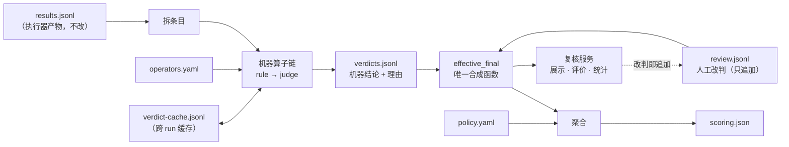

# Agent_Eval 判定算子扩展方案

版本：v2（2026-10-22），修订记录见第 15 节。

## 1. 目标与范围

本方案把判定拆成可插拔的机器算子，人工改判以覆盖层叠加，并提供复核服务，让人能逐条对照用例期望评价结果。

要达成的两个目标：

- **算子可扩展**：新增一种机器判定方式（规则、模型、观测信号）只需写一个算子并在配置中登记，不改主流程。
- **人可直观评价**：评审人在复核服务中逐条看到用例期望、回答和判定，可以改判，改判结果经唯一的合成函数参与计分。

边界：

- 编译、执行、算子判定仍按原框架以命令行运行。复核服务只负责结果处理阶段：内容展示、人工评价、结果汇总与统计，作为 `serve` 子命令实现。
- 代码改动限于 `scoring/`。文档影响面见第 13 节。
- 不改 `results.jsonl` 契约、用例结构和执行器。
- 不选 judge 模型：本方案只定义模型算子的接口。
- 并发复核不考虑。

## 2. 现状与问题

现有判定能跑通流程，但判定方式、调用顺序和计分规则都写死在 `score_episode` 一个函数里，无法扩展，人也看不到判定依据。

| 问题 | 现状（scoring.py / report.mjs） | 影响 |
| --- | --- | --- |
| 算子集合固定 | `Judges` 是装了 fact、forbidden、refusal、precond 四个函数的 dataclass | 新增判定方式要改 dataclass 和所有调用点 |
| 调用顺序写死 | `judge_fact` 内固定"有关键词先走规则，否则走 judge" | 不能按条目类型配置 |
| 判定与口径混在一起 | 禁止事实一票否决、"部分"即失败等规则写在 `score_episode` 里 | 口径未定却已固化；换口径要改代码并重新调用 judge |
| 判定结果不落盘 | 只输出聚合后的 `scoring.json`，逐条结论只在内存中 | 无法逐条复核，无法计算规则与人工的一致率 |
| 判定没有理由 | 算子只返回等级 | 评审人不知道为什么判对或判错 |
| 报告不对照 | report.mjs 只渲染对话、skill 加载和错误 | 评审人看不到 F/E/X/P 和参考答案，无处改判 |
| 默认 judge 是占位 | `_default_judges` 取事实前 6 个字做子串匹配 | 现在跑出的分数没有意义 |
| 版本对比算的是完成率 | `compare_runs` 以 `status == "ok"` 计通过 | 对比结果与判定无关 |

## 3. 总体设计

判定分三层，人工结论不进任何一层，只在取数时覆盖：

| 层 | 职责 | 输入 → 输出 |
| --- | --- | --- |
| 算子层 | 机器算子对单个条目给出结论 | 条目 + 会话上下文 → Verdict |
| 绑定层 | 决定每类条目由哪些机器算子、按什么顺序判 | operators.yaml → `verdicts.jsonl`（机器结论） |
| 口径层 | 把有效结论聚合成会话结论和统计 | 有效结论 + policy.yaml → `scoring.json` |

有效结论 = 人工改判覆盖机器结论，由唯一的合成函数 `effective_final` 计算（第 6 节）。rescore、聚合、导出、复核服务全部只经它取数。



关键性质：

- **机器结论永远完整**：人工改判不会让 `verdicts.jsonl` 失效，也不需要"影子判定"。一致率直接比较人工结论与机器结论。
- **每类条目都可人工改判**：覆盖层对所有条目类型生效，不依赖链配置。
- **判定与口径分离**：只改口径时，rescore 读 `verdicts.jsonl + review.jsonl`，不调用任何算子。
- **文件是唯一数据源**：复核服务读写运行目录里的文件，命令行流程不依赖服务是否在运行。

## 4. 算子契约与拆条规则

### 4.1 契约

所有机器算子遵守同一个契约：输入一个待判条目和会话上下文，输出一条带来源、版本和理由的结论；判不了就弃权，交给链上的下一个算子。

```python
@dataclass(frozen=True)
class Item:
    """一个待判条目，由编译行拆出，id 在用例内唯一"""
    kind: str            # required / expected / forbidden / precond / path / refusal
    id: str              # F1、X2、P1、path#1、refusal
    text: str | None     # 事实或前提文本；path、refusal 为 None
    turn: int | None     # 判定的轮次；None 表示最后一轮
    attrs: dict          # 原样带出的属性：keywords、group、evidence、action 等

@dataclass(frozen=True)
class EpisodeContext:
    record: dict                   # 一行 EpisodeRecord，原样
    case: dict                     # record["case"]，即编译行
    outputs: list[str]             # 逐轮回答，按 4.2 的规则取得
    skills_by_turn: list[set[str]] # 逐轮已加载的 skill（结果 ok 的加载）

    def answer_for(self, item: Item) -> str: ...  # 按 4.2 的轮次规则取回答

@dataclass
class Verdict:
    value: str | None    # 取自算子声明的 scale；弃权时为 None
    source: str          # rule / judge；人工覆盖后为 human
    operator: str        # 算子 id@版本，如 keyword@1；人工覆盖为 review
    reason: str = ""     # 命中片段或模型理由，给人看
    abstain: bool = False

class Operator(Protocol):
    id: str
    version: str
    source: str                    # rule / judge
    scales: dict[str, tuple]       # 条目类型 → 合法取值
    inputs: tuple[str, ...]        # 读取的输入，决定缓存键（5.3）
    def judge(self, item: Item, ctx: EpisodeContext) -> Verdict: ...
```

约束：

- **取值受 scale 约束**：输出不在声明的 scale 内即记为 error，不计入分母。各类条目的取值：

  | 条目 | 取值 |
  | --- | --- |
  | required / expected | 对 / 部分 / 未提及 / 错 |
  | forbidden | 采信 / 未采信 |
  | precond | 成立 / 不成立 |
  | path | 满足 / 违反 / 不适用 |
  | refusal | 拒答 / 未拒答 |

- **弃权不是失败**：链上全部弃权时，该条目记为 `undecided`，进入人工复核队列。
- **算子无状态**：同样的输入得到同样的输出。模型算子的模型名、温度、prompt 模板任一项变化即升版本号。
- **异常即 error**：该条目记为 error，不影响同一会话其他条目。
- **上下文只读**：算子不得修改 `record` 或 `case`。

### 4.2 拆条规则

以下均为现行行为，迁移后必须保持一致，否则新旧对拍（第 12 节步骤 1）对不上。

| 规则 | 内容 | 现行出处 |
| --- | --- | --- |
| 回答来源 | `outputs` 先取 `source == "live"` 的轮次；没有时回退到全部轮次 | scoring.py:171-172 |
| 轮次定位 | 条目写了轮次且在 1..N 内取该轮回答；未写或越界取最后一轮 | scoring.py:77-81 |
| 会话前置 | 会话 `status != "ok"` 或没有可判定的回答时，不拆条目，会话记为 error | scoring.py:168-175 |
| 判定顺序 | 前提 → 路径 → 拒答（仅 answerable=false）→ 事实与禁止事实；前一步使会话无效或失败时，后续条目仍判定并落盘，但不影响会话结论 | scoring.py:182-196 |
| refusal 条目 | 仅在 `answerable == false` 时生成一条，id 为 `refusal` | scoring.py:190-194 |
| path 条目 | 每条路径约束一条，id 为 `path#n`（n 从 1 起，按书写顺序） | CASE-STRUCTURE §2.10 |
| 组 | 组属性随条目原样带出，组语义在口径层内建（第 7 节） | CASE-STRUCTURE §2.4 |

"前一步无效时后续条目仍判定"是对现行行为的唯一扩展：现行实现提前返回，不判后续条目。新方案仍判定，是为了让人工复核能看到全部条目；会话结论不变，对拍时只比较会话结论与参与计分的条目。

## 5. 注册与算子链

### 5.1 注册

算子有两种来源，都在 `operators.yaml` 中按 id 引用：

- **内置算子**：写在 `scoring/operators.py` 内，用装饰器登记到注册表。
- **外部算子**：以 `模块路径:类名` 引用，启动时导入。新算子不必改 scoring 包。

```python
REGISTRY: dict[str, type[Operator]] = {}

def operator(cls):
    REGISTRY[cls.id] = cls
    return cls

@operator
class KeywordOperator:
    id, version, source = "keyword", "1", "rule"
    scales = {"required": FACT_SCALE, "expected": FACT_SCALE}
    inputs = ("item.attrs.keywords", "answer")

    def judge(self, item, ctx):
        kws = item.attrs.get("keywords") or []
        hit = first_hit(kws, ctx.answer_for(item)) if kws else None   # 沿用现有否定词窗口
        if hit:
            return Verdict("对", self.source, f"{self.id}@{self.version}", reason=f"命中：{hit}")
        return Verdict(None, self.source, f"{self.id}@{self.version}", abstain=True)
```

关键词未命中时 keyword 算子弃权而不是判"未提及"，与现有行为一致：规则只负责判"对"，其余交给 judge。

### 5.2 链配置

```yaml
# scoring/operators.yaml
schema: 1
operators:                       # 实例：id → 实现 + 参数
  keyword:    {impl: keyword}
  skill-path: {impl: skill-path}
  llm-fact:   {impl: "ext.judges:LlmFact", model: "<待定>", prompt: prompts/fact.md}
  llm-forbid: {impl: "ext.judges:LlmForbidden", model: "<待定>", prompt: prompts/forbidden.md}

chains:                          # 条目类型 → 依次尝试，前一个弃权才往后走
  required:  [keyword, llm-fact]
  expected:  [keyword, llm-fact]
  forbidden: [llm-forbid]
  precond:   []                  # 模型算子就绪前为空，全部未决，由人工判
  path:      [skill-path]
  refusal:   []
```

规则：

- 链上只有机器算子。人工改判不在链内，见第 6 节。
- 链为空的条目类型全部记为 `undecided`。
- 同一个实现可以按不同参数登记成多个实例（例如两个 prompt 不同的 llm-fact 做对比）。
- 链只决定"谁来判"，不决定"怎么算分"。
- 启动时校验：链中引用的实例必须存在，实例声明的 scale 必须覆盖它所在链的条目类型，否则拒绝运行。

### 5.3 跨 run 缓存

模型判定是主要成本，缓存作用域为全局，不限于单个 run：

- 缓存文件 `scoring/verdict-cache.jsonl`，只追加，跨 run 共用。`verdicts.jsonl` 仍按 run 独立存放。
- 缓存键 = `算子 id@版本` + 该算子 `inputs` 所声明的全部输入的哈希。只读条目文本和回答的算子，键就是这两项的哈希；以后某个 prompt 还读了参考答案或问题，就必须把它们声明进 `inputs`，键随之覆盖。
- 条目侧与回答侧对称：条目文本或回答任一变化都不会误命中。这也覆盖了 `--resume` 追加会话后旧结论被误复用的情况。
- 规则算子成本低，不走缓存。

## 6. 有效结论合成

`effective_final` 是有效结论的唯一出口。rescore、聚合、导出、复核服务的页面与统计都只经它取数，不另行实现组合逻辑。

```python
def effective_final(machine: Verdict, reviews: list[Review], answer_sha: str) -> Verdict:
    """有效结论 = 最后一条 answer_sha 匹配的人工改判 ?? 机器结论"""
    valid = [r for r in reviews if r.answer_sha == answer_sha]
    return valid[-1].as_verdict() if valid else machine
```

规则：

- `reviews` 为该条目在 `review.jsonl` 中的全部记录，按写入顺序。主键为 `run_id + episode_id + item_id`。
- **失效检查在函数内完成**：`answer_sha` 与当前回答不一致的改判视为作废，不参与合成。作废清单由同一模块提供，复核服务和 rescore 都从这里取，不在服务层另做检查。
- 人工结论的取值同样受 4.1 的 scale 约束；不合法的改判记为作废。
- 复核服务"改判后重算该会话"，就是对该会话各条目调用一次 `effective_final`，再按口径聚合。

## 7. 口径配置

一期不做通用规则语言，口径为一组固定参数。默认值为现行行为，保证迁移前后结论一致。

```yaml
# scoring/policy.yaml
schema: 1
partial_as: fail            # 必要事实判"部分"时：pass 视为满足 / fail 视为不满足
veto_on_forbidden: true     # 禁止事实被采信即会话失败
undecided: exclude          # 有未决条目的会话：exclude 不计入分母 / fail 记失败
headline_mode:              # 各维度的主口径
  default: natural
  错误知识纠正: forced
```

会话结论按以下顺序判定，与现行 `score_episode` 一致：

1. 任一前提不成立 → `invalid`，不计入通过率分母。
2. 路径约束违反 → `fail`。
3. `answerable == false` → 拒答为 `pass`，否则 `fail`。
4. 任一必要事实为"错"，或 `veto_on_forbidden` 为真且任一禁止事实被采信 → `fail`。
5. 必要事实全部满足 → `pass`，否则 `fail`。"满足"指结论为"对"，`partial_as: pass` 时"部分"也算满足。**组**为内建语义（CASE-STRUCTURE §2.4）：同组成员满足其一即视为该组满足，不开放配置。
6. 参与上述判定的条目中有 `undecided` 时，按 `undecided` 参数处理。

期望事实只统计命中率，不影响会话结论。一期不设事实分值映射：现有视图只消费 pass/fail，没有任何视图使用均分。口径讨论若决定"部分"计部分分，再与均分视图一并增加。

## 8. 产物契约

### 8.1 verdicts.jsonl

每行记录一个会话中一个条目的**机器**结论，按 run 存放，由命令行判定产出，复核服务只读。

```json
{
  "schema": 1,
  "run_id": "r-20261022-01",
  "episode_id": "0003-ec-0201#0-forced-t1",
  "uid": "ec-0201#0",
  "item": {"kind": "required", "id": "F1", "turn": 2},
  "machine": {"value": "未提及", "source": "judge", "operator": "llm-fact@1", "reason": "……"},
  "trace": ["keyword:abstain", "llm-fact:hit"],
  "answer_sha": "9c1e…",
  "status": "ok"
}
```

| 字段 | 含义 |
| --- | --- |
| item | 条目定位，完整文本从 results.jsonl 的编译行读取，不重复存 |
| machine | 机器算子链的结论；全部弃权时 value 为 null |
| trace | 链的执行轨迹，含缓存命中标记 `cache` |
| answer_sha | 被判回答的哈希 |
| status | ok / undecided / error |

### 8.2 review.jsonl

每行一条人工改判，按 run 存放，只追加不改写，同一条目以最后一条有效记录为准，历史全部保留。

```json
{"schema": 1, "run_id": "r-20261022-01", "episode_id": "0003-ec-0201#0-forced-t1", "item_id": "F1", "value": "对", "reason": "回答明确说收齐尾款后才能电放", "reviewer": "codfish", "answer_sha": "9c1e…", "at": "2026-10-23T10:12:00+08:00"}
```

`episode_id` 在不同 run 之间会重复，因此主键必须带 `run_id`。评审人身份由用户自报，只作记录。

人工复核不跨 run 复用：每个 run 的回答不同，`answer_sha` 不同，改判自然只作用于当次 run。规模上来后的化解路径是 01 §9 已定的做法：用积累的人工结论校准模型算子，一致率达标后转为抽样复核。

### 8.3 scoring.json 头部

现行 `judgment_snapshot`（scoring.py:270-277）升级为判定配置摘要，作为 04 §6 环境快照 `judge` 键的来源：

```json
{
  "judgment_snapshot": {
    "schema": 2,
    "operators_config_sha": "…",
    "policy_sha": "…",
    "operators": ["keyword@1", "skill-path@1", "llm-fact@1"],
    "reviews_applied": 37,
    "reviews_voided": 2,
    "undecided_excluded": 12
  }
}
```

`operators` 是本次判定实际用到的算子版本清单，多 run 对比的护栏据此判断（9.5）。`undecided_excluded` 用于给数字标注"临时"（9.3）。

## 9. 复核服务

复核服务只负责结果处理阶段的三件事：内容展示、人工评价、结果汇总与统计。编译、执行、算子判定仍是原框架的命令行流程，服务不触发它们。

### 9.1 运行方式

```text
python -m scoring serve --root out/ [--port 8765] [--host 127.0.0.1]
```

- `--root` 指向运行输出目录，服务扫描其下所有含 `results.jsonl` 的 run，按 `评测集版本 / profile id / run id` 组织。新 run 落盘后，在页面上点"重新扫描"即可导入。
- 默认只监听本机。页面含真实业务对话，需要局域网访问时显式指定 `--host`。
- 技术栈：FastAPI + Jinja2 服务端渲染，少量原生 JS，不引入前端构建链。依赖为可选安装，见第 11 节。

### 9.2 数据

- **文件是唯一数据源**：`results.jsonl`、`verdicts.jsonl`、`review.jsonl`、`run.json` 由原框架产出或由服务追加，服务不另存业务数据。
- **SQLite 只做索引**：启动或重新扫描时导入 SQLite（Python 标准库），用于筛选、分页和统计。索引文件可以随时删除重建。
- 回答正文按需从文件读取，不整体载入内存。

### 9.3 视图

| 视图 | 内容 | 用途 |
| --- | --- | --- |
| 总览 | 维度 × 模型（profile）的通过率与 Wilson 区间、前提成立率、直接作答与反问后作答分组 | 看整体结果，点击进入对应题目列表 |
| 题目视图 | 一道题（uid）的期望固定在上方；轮次为行、各 run 为列，展示每轮回答、skill 加载、反问与错误；每轮下方列出该轮条目的有效结论，注明来源（规则 / 模型 / 人工） | 同一问题跨模型对比，逐条评价 |
| 复核队列 | "未决""会话失败""人工与机器不一致"的条目，分页，快捷键切换与选择结论 | 高效逐条过人工评价 |

展示规则：

- 回答按 markdown 渲染，渲染前先净化 HTML。关键词命中片段与禁止事实相关片段在回答中高亮。
- 多轮按轮次编号对齐；某个 run 在中途失败时，该格显示失败状态与原因，后续轮留空。
- **临时数字标注**：`undecided_excluded > 0` 时，总览与对比的每个通过率旁标注"临时（已排除未决 N 条）"，防止在第一批（无模型算子）期间被当作正式结论引用。现行手册对占位分数有同样的提醒。

### 9.4 人工评价与写回

1. 评审人在条目旁选择结论、填写理由，提交即生效。
2. 服务追加一行到该 run 的 `review.jsonl`，再更新索引。
3. 对该会话调用 `effective_final` 并按口径重算会话结论，总览与队列即时更新。
4. 作废的改判（`answer_sha` 不匹配）在页面上单独列出。

### 9.5 汇总与统计

- **口径重算**：policy.yaml 修改后，页面上点"重算"即调用 rescore。rescore 读 `verdicts.jsonl + review.jsonl`，经 `effective_final` 取数，不调用任何算子。
- **多 run 对比**：选择多个 run 并声明本次对比的**预期变量**：
  - `model`：允许 `runner_profile`、`eline_profile`、`models_observed` 不同；
  - `skill`：允许 `skills_base` 不同（知识修订后的验证对比，即 01 §8 反馈闭环第 4 条）。

  放行条件：`skills_mode` 一致、判定配置摘要中的 `operators` 一致、预期变量之外的快照键一致。`evalset` 原则上要一致；不一致但 md2case 的 diff.md 只有"因降级移出"时，按现行做法对齐分母后放行。不满足即拒绝并列出不一致的键。通过率取有效结论计算，修正现行以完成率计通过的问题。
- **一致率**：有人工结论的条目，按算子与条目类型统计机器结论与人工结论的一致率，作为 01 §9 复核抽样与模型算子校准的依据。
- **导出**：统计结果可导出为 `scoring.json` 与 CSV。

## 10. 分析出口迁移清单

04 §7 定义的五类标准出口全部迁移到复核服务与 rescore，不得以功能更窄的版本替换。所有出口都从 record 与有效结论推导。

| 04 §7 出口 | 迁移内容 | 落点 |
| --- | --- | --- |
| 1 能力视图 | 维度 / 主题 / mode 的通过率与区间、前提成立率、ec 取 forced 主口径、直接作答与反问后作答分组 | 总览 |
| 2 归因视图 | natural 三分归因（未加载 / 误加载 / 加载但答错），配 forced 同 uid 通过率参照 | 总览下钻 |
| 3 用例质量视图 | 人工与机器不一致清单、规则判定一致率、变体泄露嫌疑清单、注入 found>1 清单、forced 前提成立率偏低的 ec 用例 | 复核队列与质量页 |
| 4 版本对比视图 | 按 uid 配对的通过率差与区间、快照差异键、diff.md 分母对齐 | 多 run 对比 |
| 5 锚点绊线 | 锚点 trials ≥ 2、上一 run 全部通过且本 run 全部失败即标红、`skills_mode` 不同不比较、叠加 models_observed 与快照差异键 | 多 run 对比 |

## 11. 工程形态

`scoring.py` 现为零三方依赖的单文件，加入算子、链、口径与服务后会超过两千行，拆为包。这是组件内部整理，不新增架构模块。

```text
scoring/
  __init__.py
  __main__.py         # python -m scoring <子命令>
  cli.py              # score / rescore / compare / serve
  items.py            # 拆条规则（4.2）
  operators.py        # 契约、注册表、内置算子
  chain.py            # 链执行、缓存
  effective.py        # effective_final 与作废清单
  policy.py           # 口径与会话结论
  views.py            # 第 10 节各出口
  serve.py            # 复核服务（仅此文件依赖 FastAPI / Jinja2）
  templates/
  operators.yaml
  policy.yaml
  requirements.txt    # pin 版本
```

- **依赖分层**：FastAPI 与 Jinja2 为可选依赖（`pip install .[serve]`），只有 `serve` 需要。判定、rescore、compare 的命令行路径保持零三方依赖，CI 不受服务影响。
- **契约只增不改**：`verdicts.jsonl`、`review.jsonl`、`operators.yaml`、`policy.yaml`、判定配置摘要都带 `schema` 字段。

## 12. 实施步骤与验收

| 步骤 | 内容 | 验收 |
| --- | --- | --- |
| 1 | 拆包；契约、注册表、拆条规则、链执行器、`verdicts.jsonl` 落盘；迁移 `tests/test_scoring.py` | 注册一个确定性假 judge 算子（等价于现有 `mk_judges`）进链，与旧 `score_episode` 对拍：同一份 results.jsonl 下会话结论与参与计分的条目结论全部一致，覆盖关键词命中、走 judge、组、禁止事实否决、前提无效、路径违反、拒答各路径；现有 33 个测试迁移后全部通过 |
| 2 | `effective_final`、作废清单、口径层、rescore、判定配置摘要 | 对拍测试中加入人工改判：rescore 结果与"直接修改机器结论再判定"一致；rescore 不调用任何算子；`answer_sha` 不匹配的改判进入作废清单 |
| 3 | keyword、skill-path 两个规则算子；跨 run 缓存 | 单元测试覆盖弃权、命中、全部弃权记为 undecided；缓存键在条目文本、回答、算子版本任一变化时不命中 |
| 4 | 复核服务：扫描与索引、三个视图、改判写回、临时数字标注 | 用 fixture 会话改判一条，只有该条与所属会话的结论变化，`review.jsonl` 追加一行，页面数字与 rescore 产出的 scoring.json 一致 |
| 5 | 多 run 对比、第 10 节全部出口迁移 | 预期变量为 model 时两个 run 只列出模型相关差异；预期变量为 skill 时放行 skills_base 差异；diff.md 分母对齐与锚点绊线行为与现行 `compare_runs` 一致 |
| 6 | llm-fact、llm-forbidden 两个模型算子 | 重跑同一 run、或同一评测集的另一 run，同题同答不重复调用模型；用前几步积累的人工结论报告一致率 |

步骤 1–5 不依赖模型，可以先上线，人工复核在此期间就能开展。

## 13. 文档影响面

代码改动限于 `scoring/`，但以下文档记录的接口与契约随之变化，需要同步修订：

| 文档 | 位置 | 修订内容 |
| --- | --- | --- |
| 01 业务过程总览 | §4 S9、§5 环境快照 judge 键 | S9 改为"机器算子判定 + 人工覆盖"；judge 键来源改为判定配置摘要 |
| 04 采集与结果装配 | §6 判定、§7 分析出口 | judge 函数注入改为算子链与 `effective_final`；报告呈现由 report.mjs 改为复核服务 |
| 05 概要设计方案 | scoring 模块划分 | 按第 11 节的包结构更新 |
| 06 详细设计方案 | §3.1 judge 接口 | 替换为第 4 节契约与第 8 节产物契约 |
| 07 使用手册 | §5 结果与打分 | 新增 `serve`、`rescore`、预期变量参数；更新临时数字的说明 |

## 14. 待定事项

| # | 事项 | 当前做法 |
| --- | --- | --- |
| 1 | "部分"是否算满足，是否需要计部分分 | `partial_as: fail`（现行行为）；计部分分时再增加分值映射与均分视图 |
| 2 | 禁止事实采信是否一票否决 | `veto_on_forbidden: true` |
| 3 | ec 的判定口径（CASE-STRUCTURE §11 #3）与主口径 | `headline_mode` 中 ec 取 forced；ec 解禁后再定 |
| 4 | 有未决条目的会话计入还是排除 | `undecided: exclude`，数字标注"临时" |
| 5 | 同义请求一致性：跨变体比较需以种子为单位聚合，不属于单条目算子 | 不在本方案内，定口径时作为聚合视图单独设计 |
| 6 | judge 模型选型与 prompt 模板 | 不在本方案内 |

## 15. 修订记录

### v2（相对 v1）

| # | 问题 | 修订 | 落点 |
| --- | --- | --- | --- |
| 1 | 多 run 对比护栏拒绝 skills_base 不同，误杀 01 §8 定义的知识修订验证对比 | 改为声明预期变量（model / skill）放行；保留 diff.md"因降级移出"的分母对齐 | §9.5 |
| 2 | 人工改判在链首，rescore 只读 verdicts.jsonl 时改判是否生效不明确，页面与 scoring.json 可能各算一套 | 人工从链中移出，改为覆盖层；定义唯一合成函数 `effective_final`，失效检查在函数内；删除影子判定 | §3、§5.2、§6、§8 |
| 3 | policy 伪 DSL 无法直接实现，组合规则未定义，"部分"的归属不明 | 改为固定参数集；会话结论判定顺序逐条写明；组为内建语义；去掉无人消费的分值映射 | §7 |
| 4 | 步骤 1 验收只覆盖关键词命中条目，前提的"一致"是巧合 | 用确定性假 judge 做新旧全路径对拍；迁移 33 个现有测试列入交付物 | §12 |
| 5 | 判定快照只记 policy 哈希，护栏无法按 run 判断算子版本 | 升级为判定配置摘要，含算子版本清单；列出文档影响面 | §8.3、§13 |
| 6 | 缓存作用域限于单个 run | 改为跨 run 的追加式缓存；缓存键覆盖算子声明的全部输入 | §5.3 |
| 7 | path、refusal 不可人工改判 | 覆盖层对所有条目类型生效 | §3、§6 |
| 8 | 拆条规则未写明 | 逐条列出现行行为与出处 | §4.2 |
| 9 | 04 §7 分析出口保留不全 | 列出五类出口的迁移清单 | §10 |
| 10 | 过渡期数字可能被当作正式结论 | 有未决条目被排除时标注"临时" | §8.3、§9.3 |
| 11 | 单文件会膨胀，服务依赖污染判定路径 | 拆为包；服务依赖为可选安装；各契约加 schema | §11 |
| 12 | 人工复核不跨 run 复用未说明 | 写明固有属性与化解路径 | §8.2 |
